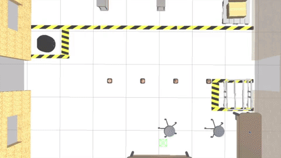

# Checkpoints 11 & 12 - Autonomous & Advanced Navigation

Full **Nav2 navigation stack + Simple Commander warehouse application** for an **RB1 mobile robot**. The robot builds a map with **Cartographer SLAM**, localizes itself with **AMCL**, autonomously navigates to goals through a **DWB local planner**, a **NavfnPlanner** global planner and a custom **behavior tree** with replanning/recovery, and finally runs a complete **pick-attach-ship-return** warehouse workflow through the **Nav2 Simple Commander API**. Supports both **simulation** and **real robot** environments via a single parameterized launch command.

Part of the [ROS & ROS 2 Developer Master Class](https://www.theconstructsim.com/) certification (Phase 2).

<p align="center">
  
</p>

## Checkpoint 11 - Nav2 Stack (SLAM, Localization, Path Planning)

<p align="center">
  
</p>

### Task 1 - Mapping (Cartographer SLAM)

1. `cartographer_node` subscribes to `/scan` and `/odom`, builds a 2D occupancy grid
2. `occupancy_grid_node` publishes the evolving map on `/map` at 1 Hz
3. User teleops the robot around the warehouse to generate the full map
4. Map saved as `warehouse_map_sim.yaml/.pgm` (and `warehouse_map_real.*` for the real robot)
5. `map_server` package reloads the saved map for downstream nodes

### Task 2 - Localization (AMCL)

1. `map_server` serves the saved warehouse map
2. `amcl` initializes a particle cloud (2000-80000 particles) and estimates robot pose on the map
3. Laser scans align with the map as the robot moves — particles converge to the true pose
4. `lifecycle_manager_localization` sequences `map_server` → `amcl` activation
5. The `/attach_service_server` is also launched here (reused from Checkpoint 9/10 for shelf attachment)

### Task 3 - Navigation (Nav2)

1. `planner_server` (NavfnPlanner / Dijkstra) computes global paths on the global costmap
2. `controller_server` (DWB local planner) tracks the path while avoiding obstacles on the local costmap
3. `bt_navigator` orchestrates navigation with a custom behavior tree (`navigate_w_replanning_and_recovery.xml`):
   - Replans global path at 5 Hz
   - On failure: clears costmaps → spins → waits → retries (up to 6 retries)
4. `behavior_server` executes recovery primitives: `spin`, `backup`, `wait`
5. `costmap_filter_info_server` + `filter_mask_server` apply **keepout zones** to exclude forbidden areas from planning
6. `lifecycle_manager_pathplanner` activates all Nav2 nodes in the correct order

## Checkpoint 12 - Simple Commander Warehouse App

<p align="center">
  
</p>

Full end-to-end warehouse pipeline in a single Python script (`nav2_apps/scripts/move_shelf_to_ship.py`) driven by the **`BasicNavigator`** class of the **Nav2 Simple Commander API**. One script handles initial pose, goal dispatch, feedback, task-result handling and recovery across four named waypoints.

### Workflow

1. **Initialization** — `BasicNavigator` boots, `setInitialPose()` publishes the known `init` pose, `waitUntilNav2Active()` blocks until the full Nav2 stack is lifecycle-active.
2. **Navigate to `loading_position`** — `goToPose()` + feedback loop polling `getFeedback().estimated_time_remaining`. Retries up to 5 attempts on `TaskResult.FAILED`.
3. **Attach shelf** — `ClientAsync` calls `/attach_service` (from Checkpoint 9/10). On success:
   - `ElevatorPublisher` publishes on `/elevator_up` to lift the shelf
   - `PolygonPublisher` swaps the robot footprint from 0.25 m square → 0.45 m cart footprint on both `/global_costmap/footprint` and `/local_costmap/footprint`
   - `RobotMover` drives 10 s backwards at -0.2 m/s to clear the loading bay
4. **Navigate to `shipping_position`** — same `goToPose` + feedback pattern with the larger cart footprint active, so the planner re-inflates around the robot+cart.
5. **Drop shelf** — at shipping, `publish_polygon('robot')` restores the small footprint, `ElevatorPublisher.drop()` publishes `/elevator_down`, `RobotMover` reverses away from the cart.
6. **Return to `init`** — final `goToPose()` back to the staging point to complete the loop.

### Key named poses

| Pose | x | y | qz | qw | Role |
|---|---|---|---|---|---|
| `init` | 0.00 | 0.00 | 0.00 | 1.00 | Staging point (sim) |
| `loading_position` | 5.70 | 0.00 | -0.70 | 0.72 | Under the shelf (sim) |
| `shipping_position` | 2.45 | 1.42 | 0.72 | 0.72 | Drop-off bay (sim) |
| `loading_position` (real) | 4.30 | 0.00 | -0.70 | 0.70 | Real lab |
| `shipping_position` (real) | 1.62 | 1.30 | 0.70 | 0.70 | Real lab |

### Helper classes (one per responsibility)

- **`ClientAsync`** — service client to `/attach_service` (sim) / `/approach_service` (real). Async call, spin-once until `future.done()`.
- **`ElevatorPublisher`** — `std_msgs/String` publisher to `/elevator_up` / `/elevator_down` with the real-robot variant publishing 5x for reliability.
- **`PolygonPublisher`** — republishes `geometry_msgs/Polygon` to `/global_costmap/footprint` and `/local_costmap/footprint`; toggles between robot (0.25 m) and cart (0.45 m) polygons at runtime.
- **`RobotMover`** — 10 s open-loop back-up on `/diffbot_base_controller/cmd_vel_unstamped` (sim) / `/cmd_vel` (real), stops with a zero-Twist.

## Tasks Breakdown

### CP11 Task 1 - Mapping (`cartographer_slam`, `map_server`)

- Created `cartographer_slam` package with `cartographer.launch.py` launching `cartographer_node` + `occupancy_grid_node` + RViz
- `cartographer_sim.lua` / `cartographer_real.lua` configuration files (tracking_frame, published_frame, odom_frame, 2D trajectory builder, scan matching)
- `mapping.rviz` with Map, TF, LaserScan displays
- `use_sim_time` launch argument switches config between sim and real
- Saved maps: `warehouse_map_sim.yaml/.pgm` and `warehouse_map_real.yaml/.pgm`
- Created `map_server` package with `map_server.launch.py` launching `nav2_map_server::map_server` + `lifecycle_manager` + RViz
- `map_file` launch argument selects which map YAML to load
- `map_display.rviz` for standalone map visualization

### CP11 Task 2 - Localization (`localization_server`)

- Created `localization_server` package with `localization.launch.py` launching `map_server` + `amcl` + `lifecycle_manager_localization` + RViz
- `amcl_config_sim.yaml` / `amcl_config_real.yaml` parameters (likelihood_field laser model, differential motion model, 60 max beams, 2000-80000 particles)
- Auto-selects sim/real AMCL config based on `map_file` suffix
- TF frames: `map` → `odom` → `robot_base_footprint`
- `localization_config.rviz` with ParticleCloud display
- `attach_service_server` node also launched (from CP9/10 shelf attachment)

### CP11 Task 3 - Navigation (`path_planner_server`)

- Created `path_planner_server` package with `pathplanner.launch.py` launching:
  - `controller_server` (DWB local planner)
  - `planner_server` (NavfnPlanner)
  - `behavior_server` (spin, backup, wait recoveries)
  - `bt_navigator` (behavior tree executor)
  - `filter_mask_server` + `costmap_filter_info_server` (keepout zones)
  - `lifecycle_manager_pathplanner`
  - `rviz2`
- `controller_sim.yaml` / `controller_real.yaml` - DWB params + local costmap (voxel + inflation + keepout layers, 3x3 m rolling window, 0.05 m resolution, 0.25 m footprint)
- `planner_sim.yaml` / `planner_real.yaml` - NavfnPlanner + global costmap (static + obstacle + inflation + keepout layers, 0.02 m resolution)
- `recoveries_sim.yaml` / `recoveries_real.yaml` - recovery behavior params
- `bt_navigator_sim.yaml` / `bt_navigator_real.yaml` - BT plugin library list
- `filters_sim.yaml` / `filters_real.yaml` - keepout mask topic and YAML path
- `navigate_w_replanning_and_recovery.xml` - custom behavior tree with replanning pipeline and recovery sequence
- `pathplanning.rviz` - full Nav2 visualization (robot model, TF, laser, odom, particles, global/local costmaps, global/local paths, global/local footprints)
- `use_sim_time` launch argument switches all configs and remaps `/cmd_vel` between sim (`/diffbot_base_controller/cmd_vel_unstamped`) and real (`/cmd_vel`)

### CP12 Task - Warehouse Workflow (`nav2_apps`)

- Created `nav2_apps` Python package with two scripts:
  - `move_shelf_to_ship.py` - simulation targets, `/diffbot_base_controller/cmd_vel_unstamped`, `/attach_service`
  - `move_shelf_to_ship_real.py` - real-lab targets, `/cmd_vel`, `/approach_service`, 5x-publish on elevator for reliability
- `BasicNavigator` wrapper for full lifecycle: `setInitialPose`, `waitUntilNav2Active`, `goToPose`, `getFeedback`, `getResult`, `TaskResult` enum
- 5-attempt retry policy around each `goToPose` call with `TaskResult.FAILED` handling
- Runtime footprint swap via `Polygon` republish (robot ↔ cart) keeps global+local costmaps consistent while carrying the shelf
- Decomposed into single-responsibility `rclpy.Node` helpers (`ClientAsync`, `ElevatorPublisher`, `PolygonPublisher`, `RobotMover`)

## Simulation vs Real Robot

Every package supports both environments through a single launch argument. The launch files use `PythonExpression` substitutions to dynamically select the correct config YAML and topic remapping at launch time.

| Environment | Map file | `cmd_vel` topic | Attach service | Controller freq |
|---|---|---|---|---|
| Simulation | `warehouse_map_sim.yaml` | `/diffbot_base_controller/cmd_vel_unstamped` | `/attach_service` | 5.0 Hz |
| Real Robot | `warehouse_map_real.yaml` | `/cmd_vel` | `/approach_service` | 5.0 Hz |

## ROS 2 Interface

| Name | Type | Description |
|---|---|---|
| `/scan` | `sensor_msgs/LaserScan` (sub) | Laser scanner data |
| `/odom` | `nav_msgs/Odometry` (sub) | Robot odometry |
| `/cmd_vel` | `geometry_msgs/Twist` (pub) | Velocity commands (remapped per environment) |
| `/map` | `nav_msgs/OccupancyGrid` (pub) | Map served by `map_server` |
| `/amcl_pose` | `geometry_msgs/PoseWithCovarianceStamped` (pub) | Localized pose estimate |
| `/particle_cloud` | `nav2_msgs/ParticleCloud` (pub) | AMCL particle distribution |
| `/global_costmap/costmap` | `nav_msgs/OccupancyGrid` (pub) | Global costmap (map + inflation + keepout) |
| `/local_costmap/costmap` | `nav_msgs/OccupancyGrid` (pub) | Local costmap (voxel + inflation + keepout) |
| `/global_costmap/footprint` | `geometry_msgs/Polygon` (pub) | Global footprint — swapped at runtime (robot ↔ cart) |
| `/local_costmap/footprint` | `geometry_msgs/Polygon` (pub) | Local footprint — swapped at runtime (robot ↔ cart) |
| `/plan` | `nav_msgs/Path` (pub) | Global path from planner_server |
| `/local_plan` | `nav_msgs/Path` (pub) | Local path from controller_server |
| `/navigate_to_pose` | `nav2_msgs/NavigateToPose` (action) | Send a nav goal to the BT navigator |
| `/attach_service` | `GoToLoading` (service) | Triggers shelf detection and final approach |
| `/elevator_up` | `std_msgs/String` (pub) | Elevator lift command |
| `/elevator_down` | `std_msgs/String` (pub) | Elevator drop command |
| `map` → `odom` → `robot_base_footprint` | TF tree | Full navigation TF chain |

## Project Structure

```
warehouse_project/
├── cartographer_slam/              # CP11 Task 1a: SLAM mapping
│   ├── launch/cartographer.launch.py
│   ├── config/
│   │   ├── cartographer_sim.lua
│   │   ├── cartographer_real.lua
│   │   ├── warehouse_map_sim.{yaml,pgm}
│   │   └── warehouse_map_real.{yaml,pgm}
│   └── rviz/mapping.rviz
├── map_server/                     # CP11 Task 1b: Map serving
│   ├── launch/map_server.launch.py
│   ├── config/
│   │   ├── warehouse_map_{sim,real}.{yaml,pgm}
│   │   └── warehouse_map_keepout_{sim,real}.{yaml,pgm}
│   └── rviz/map_display.rviz
├── localization_server/            # CP11 Task 2: AMCL localization
│   ├── launch/localization.launch.py
│   ├── config/
│   │   ├── amcl_config_sim.yaml
│   │   └── amcl_config_real.yaml
│   └── rviz/localization_config.rviz
├── path_planner_server/            # CP11 Task 3: Nav2 navigation
│   ├── launch/pathplanner.launch.py
│   ├── config/
│   │   ├── controller_{sim,real}.yaml        # DWB local planner
│   │   ├── planner_{sim,real}.yaml           # NavfnPlanner global planner
│   │   ├── bt_navigator_{sim,real}.yaml      # Behavior tree navigator
│   │   ├── recoveries_{sim,real}.yaml        # spin/backup/wait behaviors
│   │   ├── filters_{sim,real}.yaml           # Keepout zone filters
│   │   └── navigate_w_replanning_and_recovery.xml
│   └── rviz/pathplanning.rviz
├── attach_service/                 # Shelf attach service (reused from CP9/10)
│   ├── src/attach_service_server.cpp
│   └── srv/GoToLoading.srv
├── nav2_apps/                      # CP12: Simple Commander warehouse app
│   └── scripts/
│       ├── move_shelf_to_ship.py        # Simulation target
│       └── move_shelf_to_ship_real.py   # Real-robot target
└── media/
```

## How to Use

### Prerequisites

- ROS 2 Humble
- Gazebo Classic 11
- `cartographer_ros`, `nav2_*`, `nav2_simple_commander` packages
- RB1 robot simulation (`warehouse_rb1.launch.xml` from `the_construct_office_gazebo`)

### Build

```bash
cd ~/ros2_ws
colcon build
source install/setup.bash
```

### CP11 Task 1 - Mapping

```bash
# Launch simulation
ros2 launch the_construct_office_gazebo warehouse_rb1.launch.xml

# Simulation
ros2 launch cartographer_slam cartographer.launch.py use_sim_time:=True
# Real robot
ros2 launch cartographer_slam cartographer.launch.py use_sim_time:=False

# Teleop to build the map
ros2 run teleop_twist_keyboard teleop_twist_keyboard --ros-args --remap cmd_vel:=/diffbot_base_controller/cmd_vel_unstamped

# Save the map
ros2 run nav2_map_server map_saver_cli -f ~/warehouse_map_sim

# Load the saved map
ros2 launch map_server map_server.launch.py map_file:=warehouse_map_sim.yaml
```

### CP11 Task 2 - Localization

```bash
# Simulation
ros2 launch localization_server localization.launch.py map_file:=warehouse_map_sim.yaml
# Real robot
ros2 launch localization_server localization.launch.py map_file:=warehouse_map_real.yaml
```

### CP11 Task 3 - Autonomous Navigation

```bash
# Terminal 1 - Localization
ros2 launch localization_server localization.launch.py map_file:=warehouse_map_sim.yaml

# Terminal 2 - Navigation stack
ros2 launch path_planner_server pathplanner.launch.py use_sim_time:=True

# In RViz, click "2D Nav Goal" and pick a point on the map.
# The robot plans + navigates autonomously with recovery on failure.
```

### CP12 - Full Warehouse Workflow (Simple Commander API)

```bash
# Terminal 1 - Localization (also launches /attach_service)
ros2 launch localization_server localization.launch.py map_file:=warehouse_map_sim.yaml

# Terminal 2 - Navigation stack
ros2 launch path_planner_server pathplanner.launch.py use_sim_time:=True

# Terminal 3 - Warehouse application
# Simulation
python3 ~/ros2_ws/src/warehouse_project/nav2_apps/scripts/move_shelf_to_ship.py
# Real robot
python3 ~/ros2_ws/src/warehouse_project/nav2_apps/scripts/move_shelf_to_ship_real.py
```

## Git Branches

| Branch | Checkpoint | Description |
|---|---|---|
| `main` | All | Latest working code (default) |
| `task_1` | CP11 Task 1 | Mapping with Cartographer + map_server |
| `task_2` | CP11 Task 2 | AMCL localization |

## Key Concepts Covered

### Checkpoint 11

- **Cartographer SLAM**: 2D trajectory builder, online scan matching, pose graph optimization
- **AMCL localization**: likelihood-field laser model, differential motion model, particle filter convergence
- **Nav2 stack**: planner server, controller server, behavior server, bt_navigator, lifecycle manager
- **Global planner**: NavfnPlanner (Dijkstra) on global costmap with keepout zones
- **Local planner**: DWB (Dynamic Window Approach) with trajectory critics (PathAlign, GoalAlign, ObstacleFootprint, RotateToGoal)
- **Costmaps**: static layer, obstacle layer, voxel layer, inflation layer, keepout filter
- **Behavior trees**: custom XML with PipelineSequence, RecoveryNode, RateController, ClearEntireCostmap
- **Recovery behaviors**: spin, backup, wait primitives triggered on planning/following failure
- **Lifecycle management**: `lifecycle_manager` sequencing Nav2 node activation
- **Keepout zones**: costmap filter with mask topic excluding forbidden areas from planning
- **Sim/real parity**: parameterized launch files with `PythonExpression` config selection and `cmd_vel` remapping

### Checkpoint 12

- **Nav2 Simple Commander API**: `BasicNavigator`, `setInitialPose`, `waitUntilNav2Active`, `goToPose`, `getFeedback`, `getResult`, `TaskResult`
- **Asynchronous service calls**: `call_async` + `spin_once` polling with `future.done()` gating
- **Runtime footprint swap**: republishing `/global_costmap/footprint` and `/local_costmap/footprint` to inflate costmaps around the carried shelf
- **Application-level recovery**: 5-attempt retry pattern around each `goToPose`, `TaskResult.CANCELED` → return to staging
- **Multi-node Python app**: single process, multiple `rclpy.Node` instances per responsibility (client, publisher, mover)
- **Real vs sim differences in one repo**: separate script variants for lab topics/services/poses without touching the Nav2 stack

## Technologies

- ROS 2 Humble
- Nav2 (planner_server, controller_server, bt_navigator, behavior_server, lifecycle_manager)
- Nav2 Simple Commander (`nav2_simple_commander.robot_navigator.BasicNavigator`)
- Cartographer ROS
- AMCL (`nav2_amcl`)
- Gazebo Classic 11
- BehaviorTree.CPP (XML trees)
- C++ 17 / Python 3
